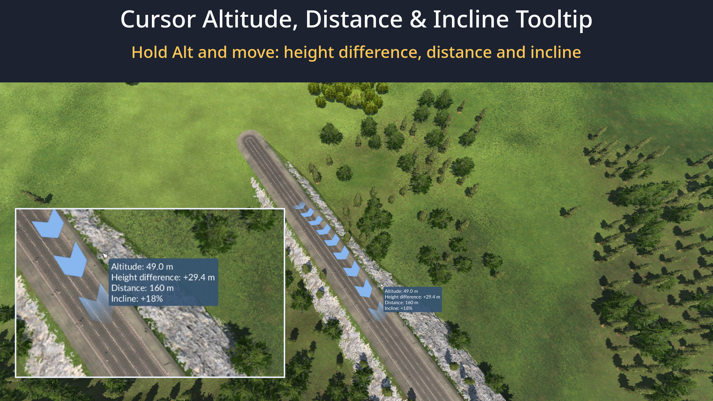
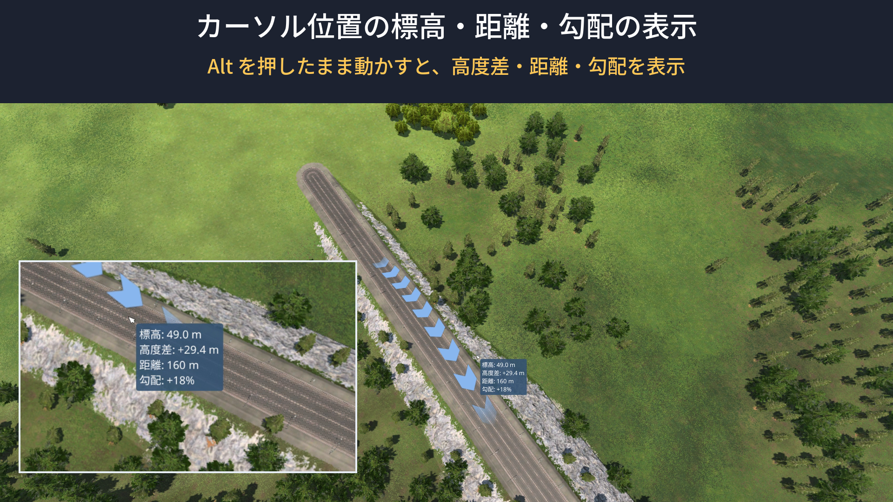

# Cursor Altitude, Distance & Incline Tooltip (Transport Fever 3)

[日本語は下にあります](#日本語)



Hold the **Surface Snapping** key (Alt by default) on the plain map view and
the cursor tooltip shows the altitude of the terrain under the mouse, instead
of the usual name tooltip. Keep holding the key and move the mouse: the
tooltip adds the height difference (signed), the horizontal distance and the
incline (%) between the point where you pressed the key and the cursor, and
a line connects the two points. Release the key and everything disappears.

Useful to check whether a road or track will fit between two places before
you build it.

## Features

- Altitude of the terrain under the mouse cursor, one decimal.
- While the key stays down: height difference (signed), horizontal distance
  and incline (whole percent) from where you pressed the key, and a line
  between the two points. Within 1 m of that point only the altitude shows.
- Follows the game's unit setting (metres / feet).
- Follows your key binding: whatever key you bind to "Surface Snapping" in
  the game's key bindings is the key that shows the altitude.
- The tooltip label is translated into all 13 languages of the game, and the mod description has a section for each.

## Where it shows, and where it doesn't

- Shows on the plain map view: no build tool, no layer, no window with its
  own cursor open. Pinned windows alone don't count.
- Not shown while a tool or a layer is active, or while a station, vehicle,
  line, industry or town window is open (they bring their own cursor and
  tooltip).
- Over buildings and water, the ground below is measured, not the roof or
  the water surface.

## Compatibility

- GUI only: nothing is saved in your savegame, so it can be added to or
  removed from a running save at any time.
- Works alongside other mods that wrap the same map-view function (both
  wraps chain).

## Install

- mod.io: <https://mod.io/g/transportfever3/m/cursor-altitude-tooltip> (or subscribe in the game's mod hub).
- Manually: the game loads a local mod only from a folder named exactly
  `hummer_cursor_altitude_tooltip_1` inside
  `<Steam>/userdata/<your id>/3493540/local/mods/`.
  - From the release zip: create that folder and extract the zip **into**
    it (the zip has no top folder of its own).
  - From GitHub: `git clone https://github.com/hummer98/tpf3-cursor-altitude-tooltip.git hummer_cursor_altitude_tooltip_1`
    inside `local/mods/` (a different folder name will not load).
  - Then enable the mod in the game.

## Development

The code is plain Lua (`content/gui/`):

| File | Role |
|---|---|
| `cat_core.lua` | Pure helpers (text, units), no engine access |
| `cat_map.lua` | Wraps the plain map view's action and swaps its tooltip |
| `cat_install.res.lua` / `.script.lua` | Hook run at UI start-up |
| `_metadata/modinfo.json` | Name, summary and description for the game's mod list and the in-game mod.io upload. The game shows one text for all languages, so the name is English and the description has a section per language |
| `_metadata/0.png` | Cover image (required by the in-game uploader, also shown in the mod list) |

Tests run offline with LuaJIT and stub the game API:

```sh
luajit tests/run.lua
```

`python3 tools/package.py` runs the tests and builds
`dist/hummer_cursor_altitude_tooltip_1.zip` with only the files the game
needs (no `.git`, tests, tools, docs, `VERSION` or `CHANGELOG.md`). LICENSE stays out too: the game's mod
validation rejects files without an allowed extension, so the mod
description states the licence and links here instead.

Versions are `MAJOR.MINOR.PATCH` in `VERSION`; `mod.json`'s `revision` is
MAJOR * 10000 + MINOR * 100 + PATCH, and changes are listed in
[CHANGELOG.md](CHANGELOG.md). `python3 tools/release.py patch` (or `minor`,
`major`, `X.Y.Z`) writes the version, the revision and the changelog
section, commits, tags `vX.Y.Z` and creates the GitHub release with
`dist/hummer_cursor_altitude_tooltip-vX.Y.Z.zip` attached (details in
[docs/release.md](docs/release.md), in Japanese).

To publish an update on mod.io, cut a release, then run
`python3 tools/stage.py` in the copy the game loads from `local/mods/`, with
the game stopped (steps in [docs/release.md](docs/release.md)). It runs the same checks, refuses uncommitted
changes or an unraised revision, and rebuilds the game's staging copy
(`local/staging_area/hummer_cursor_altitude_tooltip_1`) while keeping the
`_metadata/mod.io_fileid.txt` the game wrote at the first upload, which is
what makes the upload update this mod instead of creating a new one. Then in
the game: MOD hub > My mods > Revalidate > Update. `--keep-revision` allows
a metadata-only update. It refuses to stage without the file id, since the
upload would then create a second mod.io page. Tool tests: `python3 -m unittest discover -s tests`.

## License

[MIT](LICENSE) © 2026 hummer

---

## 日本語

# カーソル位置の標高・距離・勾配の表示（Transport Fever 3）



通常の地図画面で **「地表スナップ」キー**（初期設定は Alt）を押している間、
マウスのヒントに、通常の名前表示の代わりにカーソル位置の地形の標高を表示します。
キーを押したままマウスを動かすと、押し始めた地点からカーソルまでの高度差（符号つき）・水平の距離・勾配（%）を足して表示し、2 点の間に線を引きます。
キーを離すと、すべて消えます。

道路や線路を引く前に、2 地点の間に収まるかを見るのに使えます。

### 機能

- マウスカーソル下の地形の標高を小数1桁で表示します。
- キーを押している間、押し始めた地点からの高度差（符号つき）・水平の距離・勾配（整数の %）を表示し、2 点の間に線を引きます。押し始めた地点から 1 m 以内では、標高だけを表示します。
- ゲームの単位設定（メートル／フィート）に従います。
- キー割り当てに従います。ゲームのキー設定で「地表スナップ」に割り当てたキーで表示されます。
- ツールチップのラベルはゲームの全13言語に翻訳済みで、Modの説明文も言語ごとの段落があります。

### 表示される場面・されない場面

- 表示される：ツールもレイヤーも使っておらず、独自のカーソルを持つウィンドウも開いていない通常の地図画面。ピン留めしたウィンドウだけなら表示されます。
- 表示されない：ツールやレイヤーを使用中のとき、駅・車両・路線・産業・町のウィンドウを開いているとき（それぞれ独自のカーソルとヒントを持つため）。
- 建物や水面の上では、屋根や水面ではなく、その下の地面の高さを表示します。

### 互換性

- GUI だけの Mod で、セーブデータには何も残しません。プレイ中のセーブにいつでも追加・削除できます。
- 同じ地図画面の関数を差し替える他の Mod とも併用できます（差し替えが連鎖します）。

### 導入

- mod.io：<https://mod.io/g/transportfever3/m/cursor-altitude-tooltip>（ゲーム内の MODハブからも購読できます）
- 手動：ゲームは `<Steam>/userdata/<ID>/3493540/local/mods/` の中の、
  名前がちょうど `hummer_cursor_altitude_tooltip_1` のフォルダからだけ読み込みます。
  - リリースの zip から：そのフォルダを作り、その**中に** zip を展開します（zip には外側のフォルダがありません）。
  - GitHub から：`local/mods/` の中で `git clone https://github.com/hummer98/tpf3-cursor-altitude-tooltip.git hummer_cursor_altitude_tooltip_1` とします（別のフォルダ名では読み込まれません）。
  - そのあとゲーム内で有効にします。

### ライセンス

[MIT](LICENSE) © 2026 hummer
